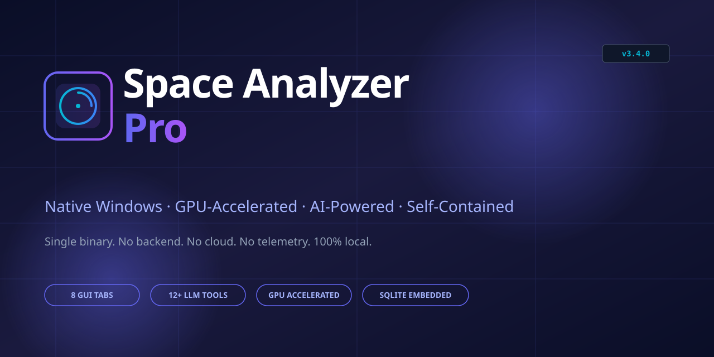
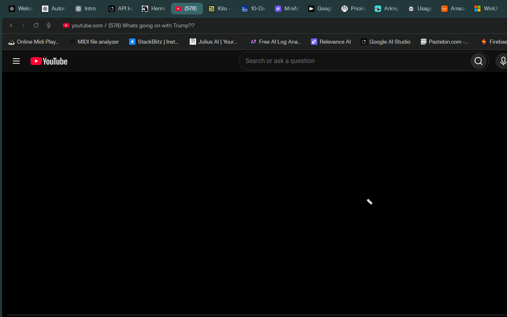
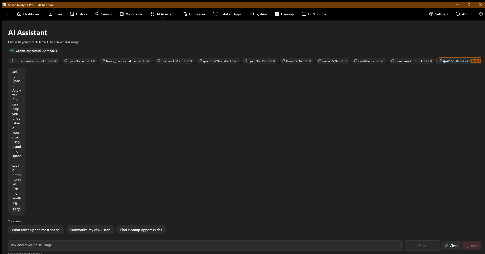

<p align="center">
  
</p>

<p align="center">
  
</p>

<p align="center">
  <a href="https://github.com/ogneocortext/space-analyzer-pro/releases/latest"></a>
  <a href="https://github.com/ogneocortext/space-analyzer-pro/blob/main/LICENSE"></a>
  <a href="https://github.com/ogneocortext/space-analyzer-pro/stargazers"></a>
</p>

<p align="center">
  <strong>Space Analyzer Pro</strong> is a native Windows disk-space analyzer with an optional local AI assistant and optional NVIDIA GPU acceleration. No cloud, no telemetry, no accounts — scan your drives, find bloat and duplicates, and reclaim space.
</p>

<p align="center">
  <a href="#download--install">Download & Install</a> &nbsp;·&nbsp;
  <a href="#quick-start">Quick Start</a> &nbsp;·&nbsp;
  <a href="#features">Features</a> &nbsp;·&nbsp;
  <a href="#cli-reference">CLI Reference</a> &nbsp;·&nbsp;
  <a href="#screenshots">Screenshots</a> &nbsp;·&nbsp;
  <a href="#development">Development</a>
</p>

---

## What it does

Space Analyzer Pro helps you find where your disk space is going and reclaim it:

- **Scan** any folder or drive — see exactly what's using space, down to individual files
- **Categorize** files into 12 groups (Documents, Images, Build Output, Archives, etc.)
- **Flag reclaimable items** — Safe / Caution / Keep tiers so you know what's safe to delete
- **Find duplicates** — parallel hashing with optional GPU acceleration, hard-link dedup to reclaim space without re-encoding
- **AI Assistant** — optional local Ollama integration; ask "what is using the most space?" and get answers
- **No cloud, no telemetry, no accounts** — everything runs locally on your machine

---

## Download & Install

### Option 1: Prebuilt binary (recommended — no build needed)

Download the latest release from the [Releases page](https://github.com/ogneocortext/space-analyzer-pro/releases/latest):

| File | What it is |
|------|------------|
| `space-analyzer-cli.exe` | Standalone command-line scanner (~7 MB) |

**To run:** download `space-analyzer-cli.exe`, open PowerShell or Command Prompt, and run:

```powershell
# Scan the current folder
.\space-analyzer-cli.exe scan .

# Scan a specific drive
.\space-analyzer-cli.exe scan D:\Projects

# Save results as JSON
.\space-analyzer-cli.exe scan . --format json --export results.json
```

### Option 2: WinUI 3 GUI (requires building from source)

The graphical desktop app is built with WinUI 3 (.NET 10 / Windows App SDK 2.4.0) and requires Visual Studio 2022. See the **[Development](#development)** section for build instructions.

> **System requirements:** Windows 10/11 x64. Optional: [Ollama](https://ollama.com) for the AI Assistant and Smart Search; an NVIDIA GPU enables faster duplicate-hashing but is not required (CPU fallback works).

---

## Quick Start

| Goal | Command |
|------|---------|
| See what's using space on C: | `.\space-analyzer-cli.exe scan C:\` |
| Scan your user folder | `.\space-analyzer-cli.exe scan %USERPROFILE%` |
| JSON output for scripts | `.\space-analyzer-cli.exe scan . --format json` |
| Find duplicate files | `.\space-analyzer-cli.exe dedup D:\Projects` |
| List mounted drives | `.\space-analyzer-cli.exe disk-info --format json` |
| Suppress progress banners (quiet mode) | `.\space-analyzer-cli.exe --quiet scan .` |
| Generate shell tab-completions | `.\space-analyzer-cli.exe completions powershell > $PROFILE` |

> **Tip:** Use `--quiet` to suppress animations and progress output — useful in scripts or CI. Use `--format json|csv|jsonl|md` for machine-readable output.

---

## Features

### Core Scanning
- Recursive directory scanning with real-time progress and cancellation
- Multi-volume disk support with usage gauges
- NTFS USN Journal scanner for incremental change tracking
- Path validation before scan starts — invalid paths rejected with a clear message
- Deep/shallow/custom depth scan modes
- Scan history with comparison, filtering, and SQLite-backed persistence

### Analysis
- File categorization into 12 human-readable groups
- Bloat detection via heuristic pattern classifier
- **Reclaimability lens** — Safe / Caution / Keep tiers with reclaimable percentages
- Storage trend prediction based on historical scan data
- AI recommendations for cleanup and optimization

### File Management
- Duplicate finder with parallel hashing and optional GPU acceleration
- Hard-link deduplication — reclaim space without re-encoding
- Destructive-action preview — see related files before deletion
- Export to JSON, CSV, HTML, and PDF

### AI Integration (Optional, requires Ollama)
- Local AI Assistant with chat and tool-calling
- Smart Search using semantic embeddings for natural-language queries
- 100% local — no cloud APIs, no telemetry

---

## Screenshots

| WinUI 3 — Dashboard | WinUI 3 — AI Assistant |
|---|---|
|  |  |

---

## CLI Reference

The CLI uses subcommands. Global flags work on every subcommand:

| Flag | Description |
|------|-------------|
| `--format text\|json\|csv\|jsonl\|md` | Output format (default: `text`) |
| `--top N` | Number of top items to show (default: `20`) |
| `--quiet` | Suppress animations, progress banners, and notices |
| `--config FILE` | Path to a TOML config file (defaults to `%APPDATA%\space-analyzer\config.toml`) |
| `--yes` | Assume "yes" for destructive prompts |
| `--no-animation` | Suppress animations |

**Common subcommands:**

```powershell
# Scan a folder (text output)
.\space-analyzer-cli.exe scan D:\Projects

# Scan as JSON
.\space-analyzer-cli.exe --format json scan D:\Projects

# Scan with age filter (files older than 30 days)
.\space-analyzer-cli.exe scan D:\ --min-age 30

# Scan quietly (no banners/progress)
.\space-analyzer-cli.exe --quiet scan D:\Projects

# Find duplicates
.\space-analyzer-cli.exe dedup D:\Projects

# Preview duplicates without deleting
.\space-analyzer-cli.exe dedup D:\Projects --apply --yes

# Inventory installed apps
.\space-analyzer-cli.exe app-inventory --format json

# Cleanup system shortcuts (list only)
.\space-analyzer-cli.exe system list --format json

# Compare two saved scans
.\space-analyzer-cli.exe diff --id1 3 --id2 7 --format json

# Lexical file search
.\space-analyzer-cli.exe search D:\ --extension rs --limit 20

# Semantic search (requires Ollama)
.\space-analyzer-cli.exe semantic-search D:\ --query "tax documents"

# Ask a question about a scan
.\space-analyzer-cli.exe ask "what is using the most space?"

# Show shell completions for your shell
.\space-analyzer-cli.exe completions powershell   # bash, zsh, fish, powershell, elvish
```

---

## Optional Setup

### Ollama (AI Assistant & Smart Search)

Install [Ollama](https://ollama.com), then pull a model:

```powershell
ollama pull llama3.2
```

Enable the AI Assistant in the GUI Settings, or use CLI commands like `semantic-search` and `ask`.

### NVIDIA GPU (faster duplicate hashing)

Duplicate hashing runs on CPU by default. An NVIDIA GPU accelerates it but is not required — CPU fallback works fine.

---

<details>
<summary>Development (build from source)</summary>

### Prerequisites

| Requirement | Required? | Notes |
|-------------|-----------|-------|
| **Rust 1.95+** | ✅ Yes | [rustup.rs](https://rustup.rs) |
| **Visual Studio 2022** | ✅ Yes (GUI only) | WinUI 3 requires MSBuild |
| **Windows 10/11 x64** | ✅ Yes | Uses Win32 APIs |

### Build

```powershell
# Build the CLI binary (release)
cargo build --release --bin space-analyzer-cli

# Build the WinUI 3 GUI
& "D:\Microsoft Visual Studio\18\Community\MSBuild\Current\Bin\MSBuild.exe" gui-winui/SpaceAnalyzer.sln -p:Configuration=Debug -p:Platform=x64

# Run the CLI
.\target\release\space-analyzer-cli.exe scan .

# Format, lint, and test
cargo fmt --all
cargo clippy --workspace --all-targets -- -D warnings
cargo test --workspace
```

The GUI drives the Rust scanner as a subprocess. Build the CLI first, then the GUI will copy the native tools into its output automatically.

</details>

---

<details>
<summary>For AI agents / automation working in this repo</summary>

> Primary issue tracker is **`docs/issues.json`** (schema v1, local-only / gitignored). Derived quick reference: **`docs/ISSUES.md`** (regenerate with `python docs/generate_status_summary.py --write`; gitignored). Do not use `docs/CONSOLIDATED_ISSUE_TRACKER.csv` as source of truth. Update workflow: find by `id:MAIN-XXX` tag in `tags[]` → fix code → update status in `issues.json` → `python docs/export_issues_to_csv.py`

</details>

---

## Documentation

- [Architecture Decisions](docs/ARCHITECTURE_DECISIONS.md) — key decisions + on-hold rules
- [Data Flow](docs/DATA_FLOW.md) — subsystem map + file locator
- [AI Integration](docs/ai/) — Ollama setup, embeddings, ML integration, benchmarks
- [Guides](docs/guides/) — troubleshooting, native builds, GPU fixes
- [Changelog](docs/CHANGELOG.md) — release notes
- [Security](SECURITY.md) — local-first security model
- [Contributing](CONTRIBUTING.md) — how to contribute

---

## Versioning

The Rust core and the WinUI 3 frontend are versioned independently but released in lockstep — both are currently **`4.3.0`**. See [CHANGELOG.md](docs/CHANGELOG.md) for full release notes.

---

## License

MIT — see [LICENSE](LICENSE) for details.
